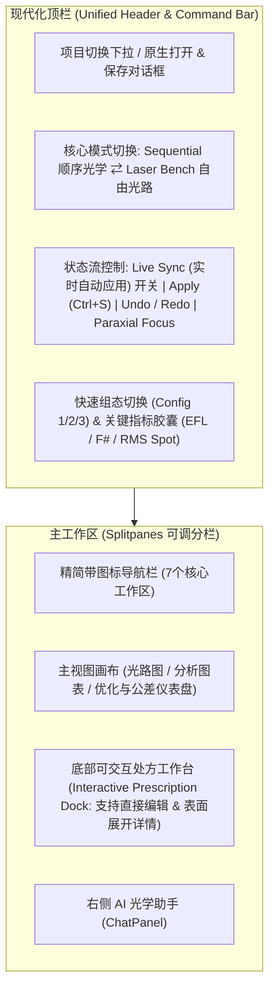

# Hissabeth 架构逻辑与现代化 UI 重构方案

针对您提出的**「逻辑不够自洽」**与**「UI 不够现代化」**两大核心痛点，我们对现有代码库（前端 Vue 3 + 后端 Rust Tauri Engine）进行了全面诊断，制定了以下系统性重构方案。

---

## 一、 现状核心痛点诊断

### 1. 逻辑不自洽的四大根源

1. **「草稿 (Draft) vs 已保存 (Saved)」双轨状态割裂**
    - 在 `Edit` 视图中，`SystemEditor` 和 `SurfaceTable` 修改的是前端内存中的 `draft`；但**同一个页面下方**的 `GapSolveEditor`（间距求解）和 `ApertureTools`（渐晕与孔径分析）却绑定在 `system`（Saved）上，且只要 `dirty === true` 就直接报错锁死（提示必须先保存或还原草稿）。
    - 所有分析视图（Layout、Spot、MTF、Analysis）、优化（Optimize）、公差（Tolerance）均只读取后端的 Saved 状态；而 `Configurations`（多组态）修改的又是 `draft`，且没有直接激活后端组态的快捷通道。用户必须高频按 `Ctrl+S` 才能看到任何参数改动的光学反馈。
2. **顺序光学 (Sequential) 与自由空间光路 (Laser Bench) 脱节**
    - `BenchView` 内部自己维护了一套独立的 `benchDraft` 和独立的 `Save Bench` 按钮，而主工具栏也有一个 `Apply Changes (Ctrl+S)`，两套脏状态（`wb.dirty` 与 `benchDirty`）互相排斥（当 `wb.dirty` 为真时，`Bench` 无法保存；当 `benchDirty` 为真时，顶栏毫无提示且 `Ctrl+S` 不生效）。
    - 在自由空间光路中选中 `Lens Group`（透镜组）时，虽然它引用了当前顺序光学处方，但缺乏直观的「透镜组参数联动预览」与双向跳转上下文。
3. **14 个一级导航平铺，信息架构高度碎片化**
    - 左侧导航栏平铺了 14 个一级标签：`Layout`、`Spot diagram`、`MTF`、`Analysis`、`Ray inspection`、`Edit`、`Optimize`、`Tolerance`、`Configurations`、`Prescription`、`Prescription report`、`Materials`、`History`、`Import / Export`。
    - **功能重叠与割裂并存**：
        - `Prescription`（只读处方表）、底部的 `Prescription Dock`（常驻只读处方表）和 `Edit`（可编辑处方表）展示了高度重复的表格，但用户在看图（`Layout` / `Spot` / `MTF`）时底栏的 `Prescription Dock` **只能看不能改**，想改一个曲率半径必须切到 `Edit` 标签页，改完按 `Ctrl+S` 再切回 `Layout` 看结果！
        - `Spot diagram`、`MTF` 是独立一级标签，而 `Diffraction MTF`、`Wavefront`、`PSF`、`Ray Fan` 却藏在 `Analysis` 标签的下拉框里。
4. **优化 / 公差 / 多组态工作流断链**
    - 在 `SurfaceTable` 中无法直接勾选哪些表面参数作为优化变量（Variable）或查看哪些参数挂了公差/多组态覆盖，必须切换到 `Optimize` / `Tolerance` / `Configurations` 手动重新选择 `S1, S2...`，极易出错。

---

### 2. UI 不够现代化的四大症结

1. **17 列超宽表格与粗糙的表单堆砌**
    - `SurfaceTable` 强行把 17 列（含非球面偶次/奇次项、环曲面 Toroid、Zernike 系数、3D 坐标断点 5 个输入框+2 个复选框）塞进同一行 `<tr>`，导致表格横向极度拥挤、输入框宽度被挤压、行高参差不齐。
2. **光学视图与图表缺乏交互联动**
    - 2D 光路截面图（`LayoutView`）与下方处方表没有高亮联动（鼠标悬停或点击表面行时，光路图对应表面不会高亮；点击光路图表面也无法定位到处方行）。
    - 图表控件（Spot / MTF / Analysis）使用简陋的原生 `<select>` 和テキスト堆砌，缺乏统一的现代科学仪器仪表盘质感。
3. **项目管理停留在「手敲文件路径」阶段**
    - 在 `Import / Export` 中打开或另存项目，竟然需要用户在 `<input type="text">` 中手动输入绝对/相对路径（尽管已引入 `@tauri-apps/plugin-dialog`，却完全没有在项目打开/另存中使用原生文件选择对话框），且顶部标题栏无法一键切换最近项目或新建/打开。
4. **视觉层级与工业设计质感不足**
    - `styles.css` 存在新旧两套样式覆盖（前 190 行旧样式与后半部分 `.industrial-app` 样式混杂），控件圆角、边框对比度、字体排版（缺乏等宽数字对齐与清晰的分组卡片Header）、图标体系（左侧导航无图标）显得早期且简陋。

---

## 二、 核心重构方案设计

### 改造模块 1：状态流与核心逻辑自洽化 (Self-Consistent State & Workflow)

1. **引入「实时同步 (Auto-Apply / Live Sync)」与「草稿自动串联提交」机制**
    - **草稿自动串联（消除锁死）**：当用户在修改了草稿（`dirty === true`）后，直接点击 `GapSolveEditor`（应用求解）、`ApertureTools`（自动渐晕）、`Autofocus`（近轴对焦）或 `Optimize`（运行优化）时，前端不再冷冰冰地报错拒绝，而是**自动先将合法的 `draft` 提交（`system_set`），紧接着无缝执行目标操作**！
    - **可选的 Live Sync（实时预览模式）**：在顶栏提供 `Live Sync`（实时同步）开关。开启且草稿校验合法（`problems.length === 0`）时，停止输入 350ms 后自动同步到后端并刷新 Layout / Spot / MTF 及一阶指标；关闭时保留手动 `Ctrl+S` 确认模式（同时兼容外部 MCP Agent 并发保护）。
2. **统一 Sequential 与 Laser Bench 的脏状态与 `Ctrl+S`**
    - 将 `BenchView` 的 `benchDraft` 纳入工作台统一的脏状态感知：当用户在 Laser Bench 中拖拽元件或修改参数时，顶栏统一显示未保存状态，按 `Ctrl+S` 或点击顶栏 `Apply` 即可一键保存当前 Bench 或 Sequential 修改。
    - 在 Laser Bench 中选中 `Lens Group` 时，右侧属性面板直接展示该透镜组引用的顺序处方摘要（面数、EFL、孔径），并提供「在顺序光路中编辑此透镜组」的一键联动按钮。
3. **底部 `Prescription Dock` 升级为「可交互/快速编辑模式」**
    - 底部常驻的 `Prescription Dock` 不再只是死板的只读表格：支持**「快速内联编辑」**（可直接修改曲率半径 `Radius`、厚度 `Thickness`、材料 `Material`、半口径 `Aperture` 并支持一键设为变量 `V`），让用户在观察 `Layout`、`Spot diagram`、`MTF` 时，**无需离开当前视图就能边改参数边看光路和像差变化**！
4. **处方表与优化/多组态联动标记**
    - 在 `SurfaceTable` 每行的 `Radius`、`Thickness`、`Conic` 旁增加直观的快捷标记徽章：点击 `V` 可直接将该面参数加入/移出优化变量列表，同时显示当前面是否有活跃的 `Gap Solve` 或 `Configuration` 覆盖。

---

### 改造模块 2：信息架构整合与导航精简化 (Information Architecture)

在保持对现有视图键值与自动化测试兼容的前提下，重构左侧导航与视图组织，将零散的视图整合为逻辑严密的 **3 大分组 + 顶栏快捷入口**：

| 分组                                  | 视图项 (配专属 Lucide 图标)                                                                                                                                                | 整合与改进设计                                                                                                                                                                                                                                                                                                                 |
| :------------------------------------ | :------------------------------------------------------------------------------------------------------------------------------------------------------------------------- | :----------------------------------------------------------------------------------------------------------------------------------------------------------------------------------------------------------------------------------------------------------------------------------------------------------------------------- |
| **观察与分析 (Inspect & Analyze)**    | **1. Optical Layout** (光路与实验台) **2. Spot & MTF** (或保留快速切换标签) **3. Aberration & Diffraction** (`Analysis`) **4. Ray Inspection** (光线追迹检查)     | • 在 `Spot`、`MTF`、`Analysis` 顶部提供统一的**「分析视图快速切换栏 (Sub-nav Pills)」**，并按类别（几何像差 / 波前与衍射 / 高斯光束）分组展示 17 种分析工具，告别冗长杂乱的原生下拉框。 • 统一各分析视图的波长、视场、采样率顶栏控制器。                                                                                    |
| **设计与工程 (Design & Engineering)** | **5. Prescription Editor** (`Edit`) **6. Optimize** (DLS 优化工作台) **7. Tolerance** (公差与蒙特卡洛) **8. Configurations** (多组态管理)                         | • `Edit` 页面采用模块化折叠/标签组织：**系统规格 (System Specs)** + **主表面编辑器 (Surface Editor + 行内高级属性抽屉)** + **间距求解与孔径工具 (Solves & Apertures)**。 • 顶栏增加**「当前活动组态 (Active Configuration)」快速切换器**，无需进入 `Configurations` 页面即可一键切换变焦组态并查看各组态下的 Layout / MTF。 |
| **项目与数据 (Project & Data)**       | **9. Prescription Report** (综合光学报告) **10. Glass Catalog** (`Materials`) **11. Revision History** (`History`) **12. Project & Exchange** (`Import / Export`) | • 合并冗余的只读 `Prescription` 到报告/底栏中（保留路由兼容）。 • 在 `Materials` 玻璃库中支持**「一键应用到当前选中表面」**，不再只是干巴巴的查询表。                                                                                                                                                                       |

---

### 改造模块 3：现代化工业级 UI 与交互升级 (Modern CAD/CAE UI)

1. **SurfaceTable「渐进式披露 (Progressive Disclosure)」重设计**
    - **主表聚焦核心 9 列**：`# (含 Stop 标记)`、`Label`、`Type`、`Radius (mm)`、`Thickness / Solve (mm)`、`Material`、`Clear Semi-Dia`、`Clip`、`Draw Semi-Dia` + 操作列。
    - **高级面型与 3D 坐标变换采用「行内展开面板 (Expandable Detail Row)」**：当某表面启用或需要编辑 Asphere（非球面系数）、Toroid（环曲面）、Zernike 或 3D Decenter/Tilt（坐标断点）时，在主行显示高亮胶囊标签（如 `Asphere`、`Tilt/Decenter`），点击即可在该行下方平滑展开结构化的参数卡片网格，彻底终结 17 列超宽横向滚动噩梦！
2. **光路图 (`LayoutView`) 与处方表双向高亮联动**
    - 引入全局 `hoveredSurfaceIndex` / `selectedSurfaceIndex` 状态：
        - 在 `SurfaceTable` 或底部 `Prescription Dock` 中悬停/选中某一行（如 `S2`）时，`LayoutView` 2D 光路图中的对应镜面曲线自动高亮发光并浮现表面参数 Tooltip（曲率、材料、口径）。
        - 在 `LayoutView` 中点击某个镜面，自动高亮并滚动定位到底部或编辑区的对应表面行。
3. **原生桌面文件对话框与顶栏项目快速切换**
    - 接入 `@tauri-apps/plugin-dialog` 的 `open()` 和 `save()` 原生文件对话框（在非 Tauri 浏览器测试环境下优雅回退到路径输入），支持一键打开 `.json` / `.zmx` 文件与另存项目。
    - 顶栏文件胶囊（`file-pill`）升级为可交互的项目菜单：点击即可快速切换 `Recent Projects`（最近项目）、新建空白系统或另存为。
4. **全面清理与升级 CSS 设计系统 (`styles.css`)**
    - 清除 `styles.css` 前 190 行的历史遗留冲突样式，建立统一的现代光学 CAD 设计 Token（精心调校的深色工业主题 `#0b0f17` / `#111827` 与高对比度浅色主题、tabular-nums 等宽数值字体、精致的微边框与悬停态、统一的工具栏与卡片头部层次）。

---

## 三、 实施步骤规划

确认方案后，我们将分 4 个阶段稳步实施并完成全量验证：

1. **阶段一：核心状态流与跨模块逻辑打通**
    - 升级 `useWorkbench.ts`：实现草稿与求解/孔径/对焦/优化的自动串联提交（消除 `dirty` 锁死）、可选的 `Live Sync` 自动保存预览、统一 `Bench` 与主工作台的 `dirty` 状态及 `Ctrl+S`、顶栏多组态快速切换。
2. **阶段二：现代化 UI 设计系统与主框架升级**
    - 重构 `styles.css` 与 `App.vue`：左侧导航栏图标化与视觉升级、顶栏项目快速切换器与状态胶囊美化、底部 `Prescription Dock` 支持内联快速编辑与表面高亮联动。
3. **阶段三：核心专业组件重构 (`SurfaceTable`、`LayoutView`、`Analysis`、`Materials`、`ImportExport`)**
    - 重构 `SurfaceTable.vue`（核心列 + 展开式高级面型/3D变换详情卡片 + 表面高亮联动）。
    - 升级 `LayoutView.vue`（镜面悬停/点击双向高亮与 HUD 信息浮层）。
    - 升级 `AnalysisPanel.vue`（分类别可视化分析选择器）、`MaterialsPanel.vue`（一键赋材到表面）、`ImportExportPanel.vue`（接入原生文件对话框）。
4. **阶段四：类型检查、代码规范与自动化测试验证**
    - 运行 `cargo test`、`bun run typecheck`、`bun run lint`、`bun run build` 及 UI 冒烟验证，确保所有重构既美观自洽又坚如磐石。
